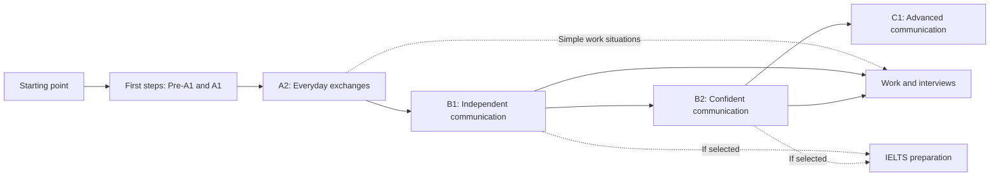

# English curriculum and learning journey: independent review

Reviewed 27 October 2026 against commit `84ff698`. This is a review and proposed roadmap, not an implemented curriculum change. The intended learner is an adult with little or basic English who wants everyday communication, meetings, employment interviews, presentations, and strong listening, speaking, reading and writing.

**Scope revision, 27 October:** the product owner clarified that American and British English must both be supported and that meetings and presentations need explicit progression. The [English curriculum plan](english-curriculum-plan.md) and [unit map](english-curriculum-units.md) now supersede this review's provisional roadmap and pilot order. The source-code findings below remain the baseline audit; they are not marked fixed by writing the plan. Implementation status and verification of subsequent repairs are tracked in the [plan milestones](english-curriculum-plan.md#implementation-status-27-october-2026).

## Verdict

**The current English offering does not yet provide that complete journey.** It is a useful intermediate starter library with selected pronunciation, conversation and IELTS activities. It needs a beginner foundation, considerably more guided practice at every level, a dedicated employment pathway, and better evidence of independent performance.

This is partly a deliberate scope decision, rather than an accidental omission. Recent changes position English at B1 to C1 and show earlier activities as a warm-up. That decision makes sense for an intermediate speaking product. It does not serve the beginner audience in this request. Expanding the audience requires revisiting the English course scope explicitly, while preserving the new visual design and interaction behaviour.

The app already answers "Which button do I press next?" much better than a loose content library. The more serious issue is whether that next activity teaches something the learner is ready for and needs for their goal.

| Learner                            | What the current app offers                                                                      | Verdict for the requested outcome                         |
| ---------------------------------- | ------------------------------------------------------------------------------------------------ | --------------------------------------------------------- |
| Cannot hold a basic conversation   | An honest beginner-course warning, followed by an A2 sound-and-stress lesson                     | No usable beginner curriculum yet                         |
| Knows words and short phrases      | Three A2 warm-up lessons, then B1 material                                                       | Missing the bridge to independent everyday exchanges      |
| Already holds simple conversations | Useful requests, repair, workplace phrases, listening and live practice                          | Helpful supplement, not comprehensive B1 coverage         |
| Preparing for a job interview      | General workplace language and two broadly interview-themed coach scenarios                      | No sequenced job-interview programme                      |
| Wants advanced communication       | Five B2 guided lessons and a C1 coach scenario                                                   | No guided C1 course; B2 coverage is also partial          |
| Wants IELTS preparation            | Seven explicitly named IELTS lessons, short reading/writing tasks and a compressed speaking mock | Useful preparation activities, not a complete exam course |

## Evidence and limits

I read all 20 English guided lessons, all nine English listening scripts, the four standalone reading texts, the English writing tasks, conversation briefs and relevant placement, course, Today and grading logic. I inspected the changes since the first Spanish pilot, its review packet, the design system and current research documentation. I used read-only Node probes to check the published order, answer grading and end-of-course recommendations.

External comparisons use current first-party product descriptions and language-teaching sources linked beside the relevant claims. Product descriptions establish advertised features, not comparative learning effectiveness. This was not a controlled study of competing apps, an observed beginner usability session, or a native-teacher sign-off. I did not listen to every English recording or exercise deployed paid feedback services. Script accuracy, actual audio quality and live assessment reliability need separate review.

### Inventory at the reviewed commit

| Surface                   | English content actually present                                                                            | What this count does not establish                                                                     |
| ------------------------- | ----------------------------------------------------------------------------------------------------------- | ------------------------------------------------------------------------------------------------------ |
| Guided lessons            | 20 classic lessons: A2 3, B1 12, B2 5; no A1 or C1 guided lessons                                           | A level label describes selected task difficulty, not full level coverage                              |
| Structured units          | No English units using the newer step-based unit format                                                     | The six objects called `CurriculumUnit` are coach scenarios, not six full teaching units               |
| Guided practice           | 120 phrase-card targets; 67 choice checks, including 22 with audio; 20 typed exercises; 20 speaking prompts | Phrase targets are not a vocabulary-size estimate; many typed exercises are single words or short gaps |
| Standalone listening      | Nine scenes: A2 2, B1 5, B2 2; 28 to 74 script words each, one comprehension question per scene             | Short scenes do not demonstrate sustained listening or broad accent comprehension                      |
| Reading                   | Four standalone texts plus two texts inside guided lessons                                                  | No graded beginner-to-advanced reading sequence                                                        |
| Extended writing          | Three tasks: chart description, course-change request, opinion essay                                        | These exist, but are not a gradual writing curriculum                                                  |
| Live conversations        | Six briefs spanning A1 to C1, including IELTS                                                               | AI flexibility is not an authored syllabus or guaranteed coverage                                      |
| Exam speaking             | Eight English cue cards; compressed IELTS Parts 2 and 3 practice                                            | The app explicitly says the five-minute call shortens Part 3 and gives no band score                   |
| Placement and checkpoints | Twenty placement items across A2, B1, B2 and C1; no English course checkpoints                              | Receptive placement does not establish productive speaking or writing ability                          |

The extended writing screen correctly distinguishes short practice from exam mode, including 150-word and 250-word exam requirements. Its smaller submission thresholds are not claims about official exam word counts. The existing `starter` labels and qualification notices are also appropriately cautious.

Repository evidence: [guided lessons](../src/features/foundations/english-lessons.ts), [listening](../src/features/listening/scenarios.ts), [reading](../src/features/reading/catalog.ts), [writing](../src/features/writing/progress.ts), [coach scenarios](../src/features/curriculum/catalog.ts), [speaking cards](../supabase/functions/_shared/speaking-cards.ts), [placement](../src/features/placement/items.ts), [level status](../src/features/foundations/level-status.ts).

## What changed after the Spanish pilot, and why it matters

The later edits corrected weaknesses in the original Spanish work, including work I had added. Those corrections should inform English authoring rather than treating the original pilot as an unquestionable template.

| Change                                                                            | Problem it addressed                                                              | English implication                                                                                          |
| --------------------------------------------------------------------------------- | --------------------------------------------------------------------------------- | ------------------------------------------------------------------------------------------------------------ |
| Split the overloaded third Spanish unit into numbers/phones and spelling/forms    | Too many new cards, symbols and tasks in one learning block                       | Do not pack the English alphabet, all numbers, dates, spelling and pronunciation theory into an opening unit |
| Added greetings before an afternoon-greeting check                                | A question tested language the learner had not been taught                        | Every marked task needs explicit prerequisite coverage                                                       |
| Corrected character identity, regional letter names and receptionist register     | Individually plausible lines did not form a consistent world or reference variety | Maintain a character, variety and register sheet for English scenes                                          |
| Blind transcription found three defective recordings, which were replaced         | Audio files could exist and decode while saying the wrong or incomplete words     | Check the recording, not just its script or manifest; human listening remains necessary                      |
| Added further units, checkpoint alternatives and lesson-linked Spanish calls      | Learners needed consolidation and a reason to use what they had learned           | Connect English calls to taught objectives and revisit them with changed details                             |
| Grounded call corrections in learner words and filtered transcription punctuation | Feedback could otherwise invent or misattribute errors                            | Keep corrections traceable; separate speech evidence from transcription guesses                              |
| Refined result sheets, retry behaviour, keyboard and scrolling                    | Feedback obscured content or interrupted mobile interaction                       | Reuse the established lesson components and keep the keyboard closed under feedback                          |
| Reworked course sections and English warm-up labels                               | Level navigation and content status needed consistency                            | Preserve the clearer course hierarchy; reconsider the English scope separately                               |

Sources: [Spanish review packet](spanish-a1-units-1-3-review.md), [unit calls](unit-calls.md), [design system](design-system.md), and commits `8d493bd`, `74febbc`, `af94420`, `44f4c96`, `48c159f`.

The Spanish packet still contains stale statements saying checkpoint 1 is pending although it is implemented. Its editorial-pass heading also does not establish completed human native approval: the packet explicitly leaves that approval pending. Use code for current inventory and a separate review record for sign-off.

## Priority findings

### 1. The beginner route starts above the learner's ability

**Priority: essential before marketing English to complete beginners.**

Both "new" and "some words and short phrases" lead to `en-sounds`. Its first session includes IPA, moving stress in photograph/photography/photographic, past-tense endings and contrastive sentence stress. These can be valuable later. They do not first teach someone to introduce themselves, ask a simple question or understand the app's English explanations.

There is no guided A1 course, systematic A2 course or beginner support-language journey. An A1 live-coach brief exists, but cannot replace those foundations. The [British Council's A1 description](https://learnenglish.britishcouncil.org/level/understand-your-level/a1-elementary) centres basic needs, introductions and supported simple interaction, with material across all four skills. That is a much more appropriate starting benchmark.

The warning in [learning-plan.tsx](../src/app/learning-plan.tsx#L98) is honest. However, it says English starts at A2 while [the course configuration](../src/features/foundations/level-status.ts#L26) deliberately presents B1 to C1 and hides A1/A2 behind "Warm-up". Resolve this mismatch when expanding the scope. Renaming existing lessons A1 would not solve it.

### 2. Goal selection changes the starting point, not the curriculum

**Priority: essential for a clear everyday and employment pathway.**

The shared course ordering is a useful improvement. However, [getTrackLessons](../src/features/foundations/catalog.ts#L44) sorts all active English lessons by level and catalog order. It does not separate everyday, employment and IELTS routes. [The recommendation function](../src/features/coaching/recommendation.ts) chooses a start, after which the shared ordering continues.

Reproduced default order:

```text
Sounds -> Small talk -> Reactions -> Polite requests -> British meanings
-> Repair -> Connected speech -> Phrasal verbs -> Common mistakes
-> Workplace messages -> Register -> IELTS Listening -> IELTS Reading
-> IELTS Writing 1 -> IELTS Speaking 1 -> Disagreement -> Paraphrase
-> IELTS Writing 2 -> IELTS Speaking 2 -> IELTS Speaking 3
```

Consequently, someone choosing everyday life is still led into exam preparation. Someone starting with workplace messages reaches IELTS shortly afterwards. The source comment calls IELTS optional, but the recommendation sequence does not implement that distinction.

Keep a common everyday foundation. Let goals select a coherent continuation and linked practice, with exam tasks in an explicit branch. Do not add a larger catalogue that learners must assemble themselves.

### 3. Some marking teaches errors or rejects valid English

**Priority: fix before expanding the existing material.**

| Finding                                             | Evidence                                                                                                                                           | Recommended correction                                                                                                                           |
| --------------------------------------------------- | -------------------------------------------------------------------------------------------------------------------------------------------------- | ------------------------------------------------------------------------------------------------------------------------------------------------ |
| Grammatically impossible accepted completion        | `en-phrasal`, check 2: `She refused the job offer. She ___ it.` accepts `turned down`, producing `She turned down it.`                             | Use `She ___ the offer.` or explicitly teach `She turned it down.` Include a pronoun-placement example                                           |
| Natural workplace answer rejected                   | `en-workplace` marks `Could you review the document when you get a chance?` as `wrong` despite its prompt requesting exactly that type of sentence | Match the task's openness to its grading method; expand legitimate variants or constrain the exercise to a specified pattern                     |
| Natural small-talk answer rejected                  | `en-small-talk` marks `Are you doing anything this weekend?` as `wrong`                                                                            | Apply the same correction; do not tell learners their natural alternative is bad English                                                         |
| Reading key does not establish a contradiction      | `en-ielts-reading` marks `All researchers support urban beekeeping` False because some warn against too many hives                                 | Rewrite the text or statement so support/opposition is explicit; warning about excessive density can coexist with support for managed beekeeping |
| A second reading key has the same reasoning problem | `sleep-tfng` marks improvement in every school False because effects varied between schools                                                        | Different-sized improvements can still occur in every school. Supply an explicit counterexample or revise the statement/key                      |

The phrasal-verb issue is a definite grammar defect. The two valid-answer rejections were reproduced by calling the actual grader. The reading findings are assessment-validity defects identified by logical analysis, not live examiner rulings: the provided wording fails to establish the marked contradiction.

The [British Council's phrasal-verb guidance](https://learnenglish.britishcouncil.org/free-resources/grammar/b1-b2/phrasal-verbs) confirms pronoun placement for separable verbs. [Official IELTS reading guidance](https://ielts.org/take-a-test/test-types/ielts-academic-test/ielts-academic-format-reading) distinguishes contradiction from information that is not established either way.

Affected code: [phrasal check](../src/features/foundations/english-lessons.ts#L518), [written-answer grader](../src/features/foundations/catalog.ts#L101), [beekeeping check](../src/features/foundations/english-lessons.ts#L940), [school-results check](../src/features/reading/catalog.ts#L111).

Do not solve open-answer grading by making every response an unconstrained AI judgement. Use deterministic marking for genuinely bounded tasks. For open writing, use a task rubric, clearly labelled feedback, and a way to dispute an incorrect correction. Keep valid alternatives and real errors in the review fixtures.

### 4. British pragmatics sometimes becomes a stereotype

**Priority: revise during the accuracy pass.**

Useful contemporary language is already present: `Could you have a look?`, `No worries`, `Fair enough`, `I didn't catch that`, and workplace chat. The problem is overconfident explanation.

- `I'll bear it in mind` is glossed as "Often: I probably won't do it." Its ordinary meaning is to remember or consider something. A dismissive implication depends on context. [Cambridge's account](https://dictionary.cambridge.org/thesaurus/articles/to-remember-something) supports the ordinary meaning; the present rejection gloss needs contextual qualification.
- The manager's `quite interesting` question asks for an attitude without supplying enough surrounding interaction. Teach a genuine consideration scene and a reluctant response scene, with audible tone and follow-up.
- `With all due respect` is not a safe default for polite disagreement. Explain that it can sound confrontational and teach alternatives appropriate to the relationship.
- `How's your week been?` is not universally more natural than `How are you?`. Teach different uses rather than ranking one as inherently native.
- The rule that weak `can` versus a full vowel in `can't` is how to distinguish them is too absolute. Include stressed affirmative `can`, context and variation. Review number stress in phrases as well as isolated teen/tens pairs.
- Avoid implying that natural English requires dense slang, fast speech, obligatory reductions or a particular personality. Recognition and productive use have different thresholds.

Support American and British English as selectable production models with shared objectives and progressively varied listening. Label informal, service and professional usage explicitly. Accept valid alternatives in context, and keep each scene speaker consistent. The updated plan specifies the necessary preference, audio, coaching and grading changes; the current implementation remains predominantly British and its recordings have not been verified for broader coverage.

### 5. Practice completion is much stronger than the evidence of ability

**Priority: essential before making proficiency claims.**

Classic lessons follow phrase study, choices, one short typed response and a self-reported speaking task. [The completion screen](../src/app/foundation/[id].tsx#L519) correctly describes speaking as something the learner marked done and says practice is not a language level. Keep that honesty.

However, choosing a response, filling `peaked at`, or saying a supplied sentence does not show that a learner can write a report, negotiate a change, or answer an unexpected question. Twenty short writing exercises cannot substitute for graduated composition. The separate writing-feedback service is useful, but its three tasks leave a large coverage gap.

English also lacks the new Spanish-style unit calls and course checkpoints. Today rotates conversations and listening chiefly by level and completion history, not by the vocabulary and functions just taught. It includes lesson/review/listening/speaking steps, but no scheduled reading or extended-writing step type. The additional skills remain separate destinations rather than a dependable four-skills learning plan.

Add supported practice, then an unfamiliar example, then independent use. Record whether help was used. Repeat a comparable task later with changed content. Keep self-practice, automated feedback and independently assessed performance distinct.

### 6. End-of-course recommendations can send learners back to introductory practice

**Priority: concrete progression bug.**

[daily-plan.ts:92](../src/features/coaching/daily-plan.ts#L92) falls back to the last lesson in the entire multilingual catalogue when there is no next lesson. At this commit that is Spanish A2, `es-used-to`.

With finished attempts for all 20 English lessons, no saved daily session and no completed standalone practice, a probe dated 27 October produced:

```text
courseFinished: true
next: null
Today: speaking:en-a1-first-contact
Fallback level source: es-used-to / A2
```

This is not evidence that all completed learners always see the same recommendation, because daily history and previous practice affect selection. It does establish that English continuation depends on unrelated Spanish catalogue order.

Choose follow-on practice from the learner's English evidence and selected goal. Say when published lessons are finished and offer relevant maintenance or advanced practice. Do not imply that the course has established a full CEFR level.

## Review of every guided English lesson

The order below is the actual published path, not raw file order. "Keep" means retain useful material after normal editorial review, not certify it as complete coverage of its level.

| Lesson ID             | Current level | Review and placement recommendation                                                                                                                                                                   |
| --------------------- | ------------- | ----------------------------------------------------------------------------------------------------------------------------------------------------------------------------------------------------- |
| `en-sounds`           | A2 warm-up    | Keep useful sound contrasts; distribute them across familiar language. Move the dense stress/IPA introduction out of the beginner's first session. Replace unsupported universal pronunciation claims |
| `en-small-talk`       | A2 warm-up    | Keep follow-ups and polite exits. Teach their question structures first; repair open-answer grading and qualify context-dependent "natural" advice                                                    |
| `en-reactions`        | A2 warm-up    | Keep reactions with context and audio. Rename the native-speaker promise around responding appropriately; avoid treating quiet responses as inherently unfriendly                                     |
| `en-softening`        | B1            | Keep modal requests and correct handling of `Would you mind`. Teach a simple request earlier, then revisit different relationships and levels of urgency                                              |
| `en-real-meaning`     | B1            | Substantially rewrite the implication and politeness explanations. Use paired scenes rather than fixed translations of British intentions                                                             |
| `en-repair`           | B1            | Strong functional topic. Introduce simple repetition/clarification requests from the first unit; retain paraphrasing and extended repair later                                                        |
| `en-connected`        | B1            | Keep receptive work on reductions; qualify `can/can't`. Do not require learners to imitate `Whaddya want?` without register and tone context                                                          |
| `en-phrasal`          | B1            | Fix the pronoun-placement error. Teach verbs in recurring situations, including their word order, rather than treating formal synonyms as less natural everywhere                                     |
| `en-mistakes`         | B1            | Useful targeted remediation. It is not a substitute for a planned grammar progression; connect errors to earlier teaching and later retrieval                                                         |
| `en-workplace`        | B1            | Keep current email/Slack/Teams contexts. Fix grading; add full messages, a response from the recipient and a revised message                                                                          |
| `en-register`         | B1            | Keep awareness of audience and letter conventions. Contrast current chat, routine email and formal correspondence; avoid a universal ban on contractions                                              |
| `en-ielts-listening`  | B1            | Put exam framing in the IELTS branch. Reuse practical numbers/spelling earlier. Supply fictional contact details instead of requesting a real phone number and birth date                             |
| `en-ielts-reading`    | B1            | Fix the ambiguous contradiction. Keep as one exam question-type lesson, with additional unseen passages rather than repeatedly learning one answer key                                                |
| `en-ielts-writing-1`  | B1            | Useful trend phrases, but its own writing check is a two-word gap. Link to the actual chart task; cover diagrams/processes and other required formats in the exam branch                              |
| `en-ielts-speaking-1` | B1            | Keep answering with relevant detail. Develop everyday personal-topic exchanges first, then exam-specific practice                                                                                     |
| `en-disagree`         | B2            | Useful diplomacy. Add a real exchange requiring clarification, an alternative and a negotiated outcome, not just recognition of an opener                                                             |
| `en-paraphrase`       | B2            | Keep reformulation but prioritise meaning preservation and useful collocations. Do not equate natural speech with replacing simple words by academic synonyms                                         |
| `en-ielts-writing-2`  | B2            | Useful argument language. The guided written check is one word, so independent essay planning, drafting and revision must follow elsewhere                                                            |
| `en-ielts-speaking-2` | B2            | Keep long-turn organisation. Use varied prompts and the existing timed mock; build fluency through original experiences, not memorised openings                                                       |
| `en-ielts-speaking-3` | B2            | Keep qualified opinions and comparisons. Sentence-count advice should be a practice aid, not a rule for a successful answer; include unpredictable follow-ups                                         |

## Gaps across the requested skills

| Area                   | What needs to be added or made systematic                                                                                                                                                                                   |
| ---------------------- | --------------------------------------------------------------------------------------------------------------------------------------------------------------------------------------------------------------------------- |
| Beginner access        | Demonstrated instructions, pictures and optional support-language explanations; slow clear models; optional alphabet/keyboard help for learners who need it                                                                 |
| Everyday functions     | Introductions, personal details, numbers and time, family, routines, likes, food, shopping, directions, travel, appointments, housing, invitations and common problems, revisited at increasing complexity                  |
| Grammar and vocabulary | A dependency map linking forms and useful chunks to functions; questions and negatives, `be`/`have`, articles/plurals, pronouns, common tenses, quantity, modality and linking, taught in context with cumulative retrieval |
| Listening              | More speakers and situations; gist, detail and action tasks; increasingly sustained passages; unfamiliar voices; transcript-assisted learning followed by clearly distinguished independent checks                          |
| Speaking               | Brief personal answers, questions, turn-taking, clarification, connected stories, opinions, negotiation and presentations; lesson-linked calls with progressively reduced support                                           |
| Reading                | Labels/forms/messages first, then correspondence, instructions, job adverts, articles and longer arguments; information transfer as well as multiple choice                                                                 |
| Writing                | Personal details and short messages first, then requests, replies, connected paragraphs, applications and reports; feedback followed by revision and a later new task                                                       |
| Pronunciation          | Recurring perception and production work on meaningful contrasts, stress, endings, rhythm, chunking and intonation; feedback tied to actual comprehensibility                                                               |
| Employment             | Read a role description, describe experience, give evidence, handle follow-ups, ask questions, explain availability and respond professionally in writing                                                                   |
| Advanced communication | Sustained multi-speaker input, implied meaning, precise register, synthesis, structured argument and extended interaction; a C1 scenario alone does not supply this                                                         |

These are proposed authoring requirements, not a claim that CEFR prescribes this exact topic or grammar order. The [CEFR Companion Volume](https://rm.coe.int/cefr-companion-volume-with-new-descriptors-2020/16809ea0d4) provides useful scales for interaction, reception, production, mediation and online communication. Its interview and writing descriptors make clear that advanced performance involves developing ideas and responding flexibly, beyond recalling phrases.

### What "like a native speaker" should mean for this product

Use the aspiration to set high standards for natural, accurate, appropriate communication. Measure whether learners are understood, understand other people, respond without a script, repair misunderstandings and choose suitable language for the situation.

A chosen American or British reference model is compatible with that ambition. Accent imitation should remain an optional preference rather than the definition of success. The [Council of Europe's revised phonology guidance](https://www.coe.int/en/web/common-european-framework-reference-languages/phonological-competence) prioritises intelligibility and distinguishes articulation from prosody. Neither variety has one native style that every learner should reproduce, and completing A1 cannot establish advanced fluency.

## Current competitors and the useful benchmark

These are documented capabilities, checked on the review date. Availability may vary by language, subscription, platform or rollout. No claim below means that Vokeno or a competitor has proved better learning outcomes.

| Product                      | Verified capability                                                                                                                                                                                                                                                                                                                                                                                                                                                                                 | Implication for Vokeno                                                                                                                                                                                   |
| ---------------------------- | --------------------------------------------------------------------------------------------------------------------------------------------------------------------------------------------------------------------------------------------------------------------------------------------------------------------------------------------------------------------------------------------------------------------------------------------------------------------------------------------------- | -------------------------------------------------------------------------------------------------------------------------------------------------------------------------------------------------------- |
| Duolingo                     | Its current publication reports English course content through B2 for most learners. It also documents speaking exercises, speaking practice and conversation tools. [Course scope](https://blog.duolingo.com/courses-teach-advanced-content/), [speaking](https://blog.duolingo.com/covering-all-the-bases-duolingos-approach-to-speaking-skills/)                                                                                                                                                 | A clear sequenced course and speaking opportunities are baseline expectations. "We have conversation" is not sufficient differentiation                                                                  |
| Busuu                        | Official support lists English A1 to C1. Its business course includes interviewing; Conversations appears in the course timeline with scenario goals and subsequent feedback. [Levels](https://help.busuu.com/hc/en-gb/articles/16519527128849-How-many-languages-can-I-learn), [business](https://www.busuu.com/en/course/learn-business-english), [Conversations](https://help.busuu.com/hc/en-gb/articles/21862192336402-What-are-Busuu-Conversations-and-how-can-they-help-me-learn-a-language) | General English, employment specialisation and linked conversation should fit together. Align the teaching objective, practice scene and next correction                                                 |
| ELSA Speak                   | Its January 2026 update describes personalised paths, role-play feedback, multi-accent training and beginner bilingual support. [Product update](https://blog.elsaspeak.com/en/discover-the-new-elsa-speak-experience/)                                                                                                                                                                                                                                                                             | Do not describe ELSA as only isolated pronunciation drills. Make Vokeno's feedback useful across successive real tasks and provide accessible beginner explanations                                      |
| U-Dictionary                 | The developer listing includes translation, dictionaries, examples, UK/US pronunciation and English-learning material. [Developer listing](https://apps.apple.com/gb/app/udictionary-translator/id1319771553)                                                                                                                                                                                                                                                                                       | Treat it as a strong reference/translation comparator. Provide help in context, then practise retrieving and using the expression. Its listing alone does not establish a complete assessed CEFR pathway |
| British Council LearnEnglish | Organises A1 resources across listening, reading, writing, speaking, grammar and vocabulary. [A1 resources](https://learnenglish.britishcouncil.org/level/understand-your-level/a1-elementary)                                                                                                                                                                                                                                                                                                      | Use this as a coverage benchmark while making the next activity easier to find than in a resource catalogue                                                                                              |

The defensible opportunity is a consistently connected experience: learn useful language, understand it in a scene, use it in a new exchange, get trustworthy feedback, revisit the weakness and see evidence of improvement. This is a design hypothesis to test, not a claim that other apps never do those things.

## Proposed English learning architecture

Retain one main course, with goal-specific practice added when the learner has the prerequisites. The following is a proposed product structure, not a completed syllabus or a guaranteed schedule.



An existing conversational learner should be able to enter later through a modest placement check and optional speaking/writing sample. A learner whose receptive and productive skills differ needs targeted support, not a single score that assumes all skills are equal. Placement should recommend; it should not force everyone through beginner content.

### The beginner unit pattern

Use the established step-based engine and short sessions. Preserve the useful rhythm from the newer units, but name the final beginner session around a real-life mission rather than an exam when no exam was selected:

1. **Meet the language:** a short scene and a small set of useful chunks, with clear meaning.
2. **Build with it:** one manageable pattern, demonstrated before the learner combines it with familiar language.
3. **Hear and respond:** supported listening, a changed detail and an appropriate reply.
4. **Use it:** a short message or form and a speaking exchange, with a small unexpected turn.

This is a flexible rhythm. Split a unit when its cognitive load requires it; do not fit content to an arbitrary four-session quota. Spiral reading, writing, pronunciation and review through the units instead of leaving them in optional menus.

The initial review proposed the following pilot outcomes. The [detailed pilot specification](english-curriculum-units.md#detailed-specification-for-the-first-three-units) now moves planning to later A1 units and makes Unit 3 a simple service exchange, reducing its prerequisite load:

| Pilot unit                       | Communicative outcome                                                             | Evidence to collect                                                                                             |
| -------------------------------- | --------------------------------------------------------------------------------- | --------------------------------------------------------------------------------------------------------------- |
| 1. Meet someone and ask for help | Greet, give a name, ask a name, ask for repetition and finish an exchange         | Understand a different speaker's introduction, complete a short supported exchange, write a simple introduction |
| 2. Tell someone about yourself   | Give simple origin, home and work/study information; ask the other person         | Answer with personal or fictional details, understand a short profile, write a few connected statements         |
| 3. Make a simple plan            | Suggest a familiar activity, agree a limited set of taught days/times and confirm | Understand a changed time, ask for confirmation and send a short confirming message                             |

Do not overload unit 3 with the entire number system, calendar, alphabet and phone/email spelling. Broader coverage belongs in subsequent units. These three pilots would validate the learning pattern; they would not complete A1.

### The employment branch

Start simple work introductions around A2 and develop fuller interviews through B1/B2, with advanced professional communication later. Roles vary, so the required proficiency and vocabulary must be explicit.

Proposed sequence:

1. Read a vacancy and identify responsibilities and requirements.
2. Introduce yourself with a relevant, concise work or study summary.
3. Explain responsibilities, achievements and reasons for applying.
4. Give a concrete example of teamwork, a problem or a mistake using a flexible STAR structure.
5. Listen to an unfamiliar follow-up, clarify it and add relevant evidence.
6. Discuss strengths, development needs, availability and role expectations honestly.
7. Ask useful questions and manage a phone/video misunderstanding.
8. Write an application or scheduling reply, then complete a varied mock interview and revise one weak answer.

The [UK National Careers Service interview guidance](https://nationalcareers.service.gov.uk/careers-advice/interview-advice) supports preparation around the role, application, examples and questions. Its [STAR guidance](https://nationalcareers.service.gov.uk/careers-advice/interview-advice/the-star-method/) stresses relevant examples, conversational delivery and follow-ups. Build language practice around those demands rather than a fixed script for "Tell me about yourself". Language improvement can support interview performance; it cannot guarantee a hiring decision.

### Keep the current design coherent

- Today keeps one clear next action and a small, bounded daily session. Reading/writing tasks should join that plan when pedagogically relevant, not create more permanent dashboard tiles.
- Course opens around the current unit, with a nearby checkpoint and optional browsing. Do not expose the complete future curriculum at first launch.
- Completion states name the capability practised and the next session. Example: "You practised asking for a different time. Next: confirm the plan in a message."
- Retain ink actions, English's orange identity, cream surfaces, shared typography, the speaking glyph, accessible touch targets and reduced-motion behaviour.
- Retain calm result sheets, in-place answer explanations and the recent mobile keyboard fixes.
- Keep a clear finish for the day. Extra practice is an option, not a punishment or an endless queue.
- Preserve existing lesson IDs, review intervals, completed history and saved starting points when moving older lessons into new units or branches.
- Update the B1-to-C1-only scope rule and related labels together if beginner English is adopted. Until then, retain honest scope notices and do not silently imply a beginner course exists.

## Milestones and acceptance criteria

| Milestone                                            | Concrete deliverable                                                                                                                        | Ready when                                                                                                                                       |
| ---------------------------------------------------- | ------------------------------------------------------------------------------------------------------------------------------------------- | ------------------------------------------------------------------------------------------------------------------------------------------------ |
| 0. Repair existing trust issues                      | Correct faulty/ambiguous items, prompt/grader mismatches, overconfident pragmatic rules, end-of-course fallback and inconsistent scope copy | Exact reproductions are resolved; valid alternative answers and unambiguous wrong answers are checked                                            |
| 1. Define English coverage and routes                | A function/grammar/vocabulary/four-skills map from first steps onwards, with everyday, employment and exam route rules                      | Every planned unit has prerequisites, outcomes, review links and evidence tasks; no claim of full coverage rests on a lesson count               |
| 2. Build and review three beginner pilot units       | Short authored sessions, recordings, linked speaking practice and a cumulative transfer task                                                | A British-English teacher, native reviewers and beginner observations find no blocking defects; scripts and actual audio are reviewed separately |
| 3. Complete the A1 foundation, then A2               | The remaining mapped content with cumulative practice and parallel checkpoint versions                                                      | Coverage is implemented and reviewed; independent tasks and delayed retests support the intended outcomes across skills                          |
| 4. Rebuild B1/B2 around communication and interviews | Reuse corrected existing lessons inside coherent units; add employment progression and separate IELTS routes                                | Learners can handle unfamiliar follow-ups, practical texts and original writing, with observed evidence rather than just completion              |
| 5. Add advanced depth and validate claims            | C1 teaching, sustained input/output and varied professional interaction                                                                     | Qualified reviewers assess varied learner performances; public claims match demonstrated coverage and results                                    |

The existing intermediate accuracy fixes and route design can proceed before a full beginner course is finished. Do not withhold useful existing intermediate practice while building the new foundations.

### Quality gates for future English units

Each unit needs an objective-to-task map, prerequisite list, taught/reviewed language inventory, accepted-answer review, script/audio review record and content version. American and British English reviewers check their respective scripts and recordings for naturalness and register; a qualified English teacher checks level, explanation and progression. Beginner observation checks whether the teaching actually works. No single reviewer substitutes for all those roles.

Audio review must include names, numbers, final sounds, stress, reductions, actual playback and consistency between question and recording. Blind transcription is useful for finding defects, not proof of native naturalness or a replacement for listening.

A checkpoint should sample unseen listening and reading, original short writing, and an interaction with changed details. Separate understanding from reading a transcript, and independent production from copying a model. Self-reported speaking can support practice completion but must not alone establish speaking proficiency. The current 80% checkpoint rule can remain a practice milestone; a percentage and a "said it" tick cannot independently certify a level.

For pilot evaluation, observe first-session comprehension, ability to find the next task, valid answers rejected, reliance on hints, success with changed details, and delayed retention. For interview practice, inspect relevance, comprehensibility, example quality and response to follow-ups. Track return visits alongside these learning outcomes, not as their substitute.

### Verification performed for this review

- Imported the actual published catalog and counted English formats, levels, phrase targets and check types.
- Executed `getTrackLessons('EN')` to establish the real recommendation order.
- Executed `gradeFoundationWriting` on both natural alternatives above; each returned `{ status: 'wrong' }`.
- Executed `buildTodayPlan` with all English guided lessons completed; reproduced the introductory-conversation fallback described above.
- Inspected the writing screen's short-practice versus exam requirements, the speaking mock's stated limits and the course's starter notices to avoid misrepresenting existing capabilities.
- Compared recommendations with the linked primary sources. No application behaviour, lessons, audio, accounts or remote services were changed during this review.
